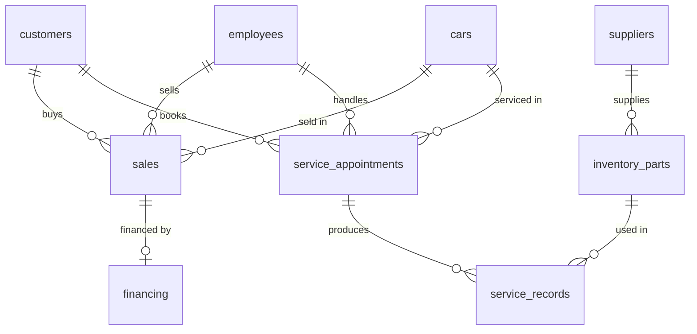

# Car Dealership Management System

A PostgreSQL database for running a car dealership: inventory, customers, employees, sales, financing, parts, and service. Built as my final project for Database Management (CMPT308) at Marist University, Spring 2025.

## What's in it

| Piece | Details |
|-------|---------|
| **Tables** | `customers`, `employees`, `cars`, `sales`, `financing`, `suppliers`, `inventory_parts`, `service_appointments`, `service_records` |
| **Constraints** | Primary/foreign keys, `CHECK` constraints on phone, state, ZIP, year, price, status, and role |
| **Generated column** | `cars.condition` is computed from mileage (`new` at 150 miles or less, otherwise `used`) |
| **Views** | `new_inventory`, `used_inventory`, `bmw_inventory`, `top_customers`, `detailed_service_appointments` |
| **Stored procedure** | `register_sale()` records a sale and marks the car as sold in one call |
| **Trigger** | `trg_after_sale` books a first service appointment with a random service tech after every sale |
| **Access control** | Roles for owner, manager, sales rep, and service tech, each with only the privileges that job needs |

## Schema



## Role-based access

| Role | Can do | Can't do |
|------|--------|----------|
| `owner_role` | Everything, and can grant privileges to others | |
| `manager_role` | Manage inventory, sales, staff, and service | |
| `sales_rep_role` | View customers and inventory, record sales | Update customer records, see employee data |
| `service_tech_role` | Work service appointments and records, view parts and suppliers | See sales or financing, change car prices or status |

I tested these by switching roles. For example, a service tech gets `permission denied` on `SELECT * FROM sales`, and a sales rep can't `UPDATE customers`.

## Run it

```bash
createdb dealership
psql -d dealership -f schema.sql
```

Then try:

```sql
SELECT * FROM top_customers;
SELECT * FROM used_inventory;
SELECT register_sale(2, 4, 'WBAGX5C51MC654321', 60000);
SELECT * FROM detailed_service_appointments ORDER BY appointment_id DESC;
```

> The script creates demo login roles with the placeholder password `change_me`. Change them, or remove the user section, before running it anywhere that isn't a throwaway database.

## Known limitations
- The sample `sales` rows are inserted directly, so those cars still show as `available`. New sales should go through `register_sale()`.
- A few sample service appointments are assigned to a manager rather than a service tech.
- The trigger picks a technician at random instead of by workload.

## What I learned
- Pushing rules into the database (constraints, generated columns, triggers) keeps the data valid no matter which app writes to it.
- Least privilege applies to databases too. Roles let each job see only what it needs.

## Skills demonstrated
SQL, PostgreSQL, PL/pgSQL, relational design and normalization, views, triggers, role-based access control

## License
[MIT](LICENSE). All names, emails, and phone numbers in the sample data are fictional.
